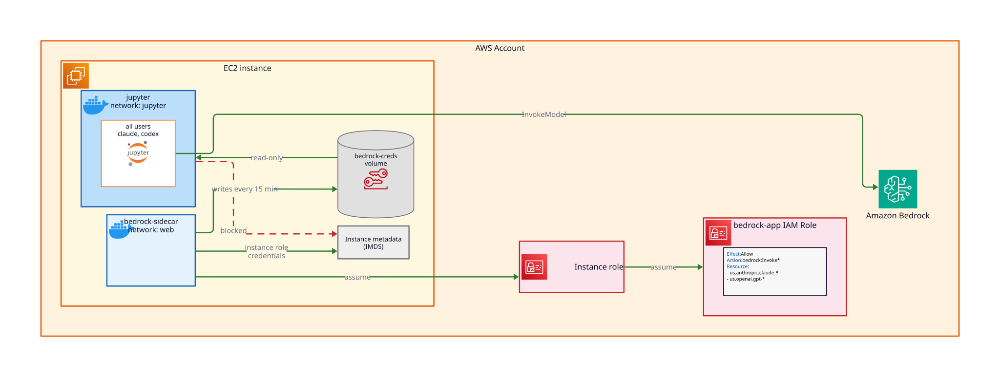

# Bedrock Integration

The Jupyter image ships the **Claude Code** (`claude`) and **Codex** (`codex`) coding agents, pinned
to `claude_code_version` and `codex_version` and pointed at Amazon Bedrock. `bedrock_enabled` is
`true` by default, so both work in a **JupyterLab** terminal with no setup: run `claude` or `codex`.



A `bedrock-app` IAM role, limited to invoking the allowed models, backs both agents: a `bedrock-sidecar`
container assumes it and hands short-lived credentials to the `jupyter` container read-only. The
`jupyter` container cannot reach the instance metadata service, so it never sees the instance role.

## AWS credentials in notebooks

The default AWS credential chain in the `jupyter` container (`boto3`, AWS CLI) resolves to the
`bedrock-app` role with Bedrock on, and to nothing with it off. Notebook code that relied on the
instance role stops working, on upgrade too. To use your own profiles, run
`export AWS_CONFIG_FILE=$HOME/.aws/config`; a `~/.aws/credentials` file always takes precedence.

```{warning}
Every user of the app shares the `bedrock-app` role, and therefore the same Bedrock credentials.
Bedrock usage is not attributable per user: AWS CloudTrail records every call under that role.
```

## Enable the models in your account

Bedrock enables a third-party model (Anthropic Claude, OpenAI GPT) on its first invocation in an
AWS account, by subscribing the account through AWS Marketplace, once per account. That invocation
accepts the provider's EULA: review the terms first.

```{warning}
The `bedrock-app` role holds no AWS Marketplace permissions, so an admin must make that first call for each model.
A call from the agents fails with `AccessDeniedException` until then.
```

With a principal allowed to subscribe through AWS Marketplace, in the deployment's region:

1. **Anthropic only**: submit the first-time-use form, once per AWS Organization. Open any Anthropic
   model in the Bedrock console model catalog and submit your use case details.
2. **Each model**: open the model in the Bedrock console playground and send one prompt.
3. **Wait**: the agreement can take up to 15 minutes to become available.

## Choose the inference scope

`bedrock_inference_scope` selects the cross-region inference profiles the agents call Bedrock through:

| Scope | Profiles | Where Bedrock serves requests |
|---|---|---|
| `geo` (default) | the region's geography, e.g. `us.` in `us-west-2` | within that geography |
| `global` | `global.` | any commercial region |

`geo` maps the region to its geography: `us.`, `eu.`, `jp.` for Tokyo and Osaka, `au.` for Sydney,
`us-gov.`; other commercial regions fall back to `global.` with a plan-time warning. Bedrock offers
the OpenAI models through `us.` and `global.` profiles only, so outside the US **Codex** needs `global`.

## Choose the models

`bedrock_model_patterns` lists the Bedrock model IDs the `bedrock-app` role may invoke, as IAM
wildcards without the inference profile prefix. The default allows both agents:

```yaml
overrides:
  bedrock_model_patterns:
    - anthropic.claude-*
    - openai.gpt-*
```

Each agent picks its default model per release: **Claude Code**'s default must stay within the
patterns, and **Codex** uses the best model its release offers among the allowed ones.

## Pin the agent versions

`claude_code_version` and `codex_version` pin the agents installed in the Jupyter image. Changing
either one rebuilds the image on the next `jd up`.

## Turn it off

Set `bedrock_enabled` to `false` in `variables.yaml`, then run `jd config` and `jd up`:

```yaml
overrides:
  bedrock_enabled: false
```

The deployment then has no `bedrock-app` role, no sidecar and no credentials file, so the agents
fail. Notebooks and terminals get no AWS credentials from the default chain; bring your own as above.

The project's `TROUBLESHOOT.md` covers the failure modes and the AWS CLI commands to enable the models.
